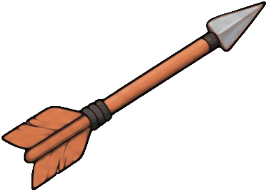
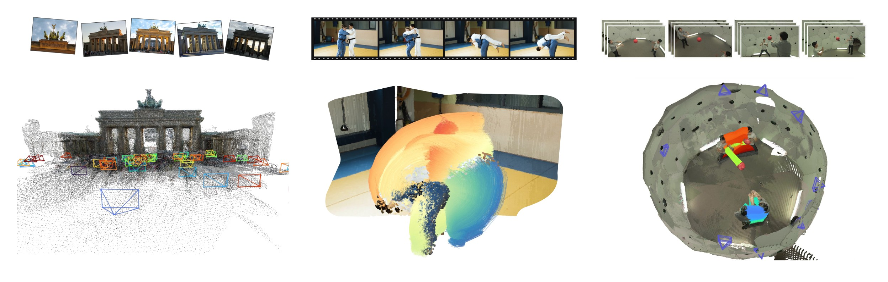

<h1 align="center">
  <picture></picture>
  ARROW
  <picture></picture>
</h1>

<h3 align="center">Arbitrary Reconstruction and Tracking<br />of 4D Observations in the Wild</h3>

<p align="center">
  <a href="https://ifradlin.github.io">Ilya&nbsp;Fradlin</a> &nbsp;&nbsp;
  <a href="https://github.com/Schmiddo">Christian&nbsp;Schmidt</a> &nbsp;&nbsp;
  <a href="https://github.com/jenspiek">Jens&nbsp;Piekenbrinck</a><br />
  <a href="https://karimknaebel.com">Karim&nbsp;Knaebel</a> &nbsp;&nbsp;
  <a href="https://gonzalomartingarcia.com/">Gonzalo&nbsp;Martin&nbsp;Garcia</a> &nbsp;&nbsp;
  <a href="https://scholar.google.com/citations?user=ZcULDB0AAAAJ">Bastian&nbsp;Leibe</a>
</p>

<p align="center">RWTH Aachen University</p>

<p align="center">
  <a href="https://vision.rwth-aachen.de/arrow"></a>
  <a href="https://arxiv.org/abs/2610.01314"></a>
  <a href="#citation"></a>
</p>

<p align="center">
  <br />
  <picture></picture>
</p>

## Updates

**Coming next:** evaluation and training code.

- **2026-10-12:** Inference code, pretrained weights, and an interactive viewer are released.
- **2026-10-01:** Our [paper](https://arxiv.org/abs/2610.01314) is available on arXiv.

## Overview

**ARROW** is a feed-forward model that unifies **3D reconstruction and 3D point tracking from arbitrary image sets**. It combines the flexible point-query decoding of [D4RT](https://d4rt-paper.github.io/) with support for arbitrary observations across viewpoints and capture times. This enables reconstruction and tracking from moving-camera videos, multiple video streams, and unordered photo collections.

ARROW achieves state-of-the-art 3D tracking on WorldTrack and TAPVid-3D and outperforms dedicated multi-view trackers on an adapted **RGB-only MVTracker benchmark**, remaining competitive on 3D reconstruction tasks.

Visit the [project page](https://vision.rwth-aachen.de/arrow) for interactive examples and results.

## Installation

Clone the repository and install with [uv](https://docs.astral.sh/uv/):

```bash
git clone https://github.com/ifradlin/arrow.git
cd arrow
uv sync
```

This installs ARROW into `.venv` in editable mode.
On Linux and Windows, `uv sync` installs PyTorch built for CUDA 13.0 (needs a recent NVIDIA driver).
On macOS it uses Apple Silicon GPUs (MPS).
ARROW picks CUDA, MPS, or CPU automatically. To choose a device, pass `--device cpu`
(or `cuda:1`, `mps`) to `arrow infer` or `arrow-viewer`, or `device=` to `ARROW.from_pretrained()`.

For the [interactive viewer](#viewer), add `--extra viewer`; for development
(tests, linting, type checking), add `--group dev`.

## Viewer

Run inference and view 3D reconstructions, point tracks, depth, and camera
poses directly in the interactive viewer:

```bash
uv sync --extra viewer
uv run arrow-viewer
```

Open **http://127.0.0.1:7860** to select input images or videos, choose tasks, and
adjust run parameters such as frame selection and query spacing. Run inference
and visualize the results directly in the viewer. See the [viewer guide](docs/VIEWER.md)
for input selection, run controls, layers, coloring, and filters.

## Usage

Alternatively, track points from the CLI and use the viewer to visualize the saved
predictions. This example takes every third video frame and uses the remaining
defaults from [configs/inference.py](configs/inference.py):

```bash
uv run arrow infer assets/videos/railway.mp4 --stride 3 --output results/railway.npz
```

The command saves `results/railway.npz` with the prepared input images, every
query (pixel, source, target, and reference frame), its predictions (3D points,
confidence, visibility, normals, ...), and metadata describing the frames and
tasks. View the saved results in the viewer:

```bash
uv run arrow-viewer --scene results/railway.npz
```

This opens the saved predictions as a scene at **http://127.0.0.1:7860**.
See [all options](docs/INFERENCE.md#command-line-and-configuration) for other tasks,
grid spacing, and frame selection.

The same run from Python:

```python
from arrow import ARROW
from arrow.infer import infer, load_input

model = ARROW.from_pretrained("ifradlin/arrow", device="auto")
observations = load_input("assets/videos/railway.mp4", stride=3)
result, encoded = infer(model, observations)
```

Weights download on first use. A local model directory also works; pass it to
`from_pretrained()` or use `--checkpoint /path/to/model`.
See [inference examples](docs/INFERENCE.md) for selected-point tracking,
multi-view input, poses, and saved predictions.

## Citation

```bibtex
@article{fradlin2026arrow,
    title         = {{ARROW}: Arbitrary Reconstruction and Tracking of 4D Observations in the Wild},
    author        = {Fradlin, Ilya and Schmidt, Christian and Piekenbrinck, Jens and Knaebel, Karim and Martin Garcia, Gonzalo and Leibe, Bastian},
    year          = 2026,
    journal       = {arXiv preprint arXiv:2610.01314},
}
```

## License

See [LICENSE](LICENSE) for code and pretrained-weight terms. Weights are for
non-commercial use and are also subject to the linked Waymo terms.
